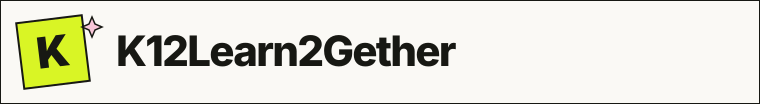
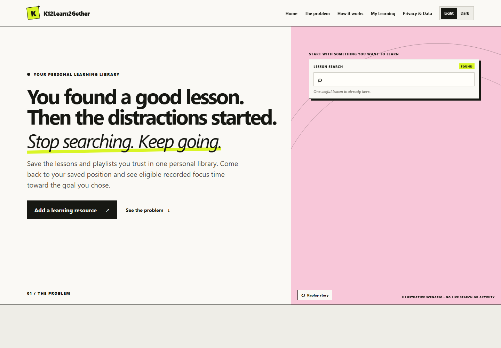

<h1 align="center"></h1>

<p align="center"><strong>Less searching. More finishing.</strong></p>

Learners often already have a lesson or playlist they trust. K12Learn2Gether helps them save it in a Personal Learning Library, return to a saved playback position, study in a focus-aware workspace, and see eligible recorded focus toward a goal they chose.

<p align="center">
  
</p>

## The problem

After finding a useful lesson, a learner can get pulled into recommendations, teacher comparisons, playlists, roadmaps, and repeated searching. Losing a playback position can make it harder to return to the same learning thread. This is the product's motivating scenario, not a formal research finding or a measured outcome.

## The idea

```text
Choose a trusted resource
          ↓
Save it in your library
          ↓
Return with Continue Learning
          ↓
Restore the saved position, paused
          ↓
Study with eligible activity recording
          ↓
See and share your recorded effort
```

## What it does

- **Personal Learning Library:** save multiple YouTube videos or supplied playlists, each with its own name, subject, learning objective, focus goal, and progress. Continue Learning returns to a saved resource.
- **Resume continuity:** the app restores the last confirmed playback checkpoint and leaves the player paused until the learner chooses Play. IFrame-derived checkpoints expire after 30 days; a video that has not been opened again may return to the beginning.
- **Focus-aware workspace:** eligible recorded activity requires an active study session, a playing player, a visible page, and confirmed browser-window focus. Supported interruption signals stop recording; they cannot prove human attention.
- **Focus Cup and summaries:** choose a glass, coffee cup, mug, or bottle. The visual fill follows recorded focus relative to the selected goal and caps at 100%; recorded minutes remain uncapped. My Learning shows available Today, Week, Month, Year, and lifetime totals. A local calendar day qualifies for the streak at 10 minutes of eligible activity.
- **Learner-marked completion:** a lesson is marked complete only after the learner chooses that action. This records their choice; it does not measure mastery.
- **Share progress:** create Daily Focus, Learning Recap, and eligible Goal Reached cards from saved app data. Cards export as 1080×1350 PNGs; native image sharing is offered when the browser supports it, with PNG download available.
- **Presentation and access:** responsive layouts, keyboard-operable controls, reduced-motion support, and a browser-local light/dark preference.
- **YouTube eligibility preflight:** before creating a player, the app checks `status.madeForKids` for a video or every resolved video in a supplied playlist. MFK, unknown, unresolved, or unverifiable content is blocked. The preflight requires a restricted YouTube Data API v3 key.

Recorded focus is a productivity proxy based on player and browser signals. It is not proof of attention, comprehension, mastery, or verified learning.

### Resume in practice

```text
Watch to 06:13 → leave → return with Continue Learning
              → restore near 06:13 → press Play when ready
```

The app restores its last confirmed checkpoint; it does not promise frame-perfect positioning.

## Built with

React, TypeScript, and Vite; YouTube IFrame Player API and YouTube Data API v3; browser `localStorage`; Vitest and Playwright.

### How it works

```text
React UI
   ↓
Domain rules and progress selectors
   ↓
FocusController + YouTube player/preflight adapters
   ↓
Validated, versioned browser-local persistence
```

The application has no backend or account system. The UI coordinates the flow, domain modules calculate resource and progress state, adapters handle browser/player signals and API checks, and the persistence repository validates local records.

For the product boundary and build record, see the [scope](devpost/scope.md), [PRD](devpost/prd.md), [technical spec](devpost/spec.md), [build checklist](devpost/checklist.md), and [manual browser checks](devpost/manual-browser-checks.md). The planning amendments are still marked draft for learner review; the implementation has continued to evolve, and the original approved planning history remains in Git.

## Run locally

### Requirements

- Node.js 24.15 or later in the 24.x line and npm.
- A modern browser with JavaScript, `localStorage`, Canvas, and YouTube embedded-player support.
- Internet access and a restricted YouTube Data API v3 key for resource eligibility checks and playback.

```bash
git clone https://github.com/muhammad-harisk23/learning2gether.git
cd learning2gether
npm ci
```

Create a Google Cloud project, enable **YouTube Data API v3**, and create an API key restricted to that API and the exact development/production HTTP referrers. Copy `.env.example` to `.env.local` and set `VITE_YOUTUBE_API_KEY`. Vite exposes `VITE_` values in browser code, so this is a public, referrer-restricted key, not a secret; never use an unrestricted key or commit a real value. Configure the production key in the deployment environment for its actual origin.

```bash
npm run dev
```

Open the local URL printed by Vite. Without a key and explicit `madeForKids: false` status for every video, the app fails closed and does not create a player. Automated browser tests mock the Data API boundary and do not need a real key.

## Validation

```bash
npm run typecheck
npm test
npx playwright test --workers=1
npm run build
npm run preview
```

The test suites cover domain and persistence rules, resource-library flows, playback checkpoint restoration, focus eligibility, Focus Cup behavior, sharing, and browser layouts. The real YouTube embed smoke test still depends on YouTube availability and an eligible resource.

## Privacy and data

- There is no app account, backend, analytics service, or cloud storage. Learner library and progress data live in `localStorage` for the current browser profile and site origin. There is no in-app delete control; clearing that site's browser data removes local progress. Another profile or device has separate data.
- Learner-provided/application data includes the canonical URL and video/playlist IDs parsed from it, resource name, subject, objective, focus goal, completion choice, and vessel preference. These remain saved even when a checkpoint expires. YouTube API-derived data includes MFK status, playlist items/order, player-selected playlist video ID, returned title, and player position; API results and titles are not cached as a library.
- YouTube is a third-party service. The app checks MFK status before embedding. IFrame-derived playback checkpoints and player-selected playlist IDs have timestamps and are discarded after 30 days; the saved resource remains and, after successful revalidation, playback starts from the beginning. A video ID parsed from the learner-supplied URL remains application data.
- K12Learn2Gether recorded focus is an app-owned study-session metric. It is not a YouTube metric and does not measure YouTube engagement, verified attention, comprehension, or mastery. YouTube policy treatment of independently derived metrics remains ambiguous; this wording does not resolve that issue. YouTube's player may send data to YouTube/Google and may display ads.
- Privacy details and links to the [YouTube Terms of Service](https://www.youtube.com/t/terms) and [Google Privacy Policy](https://policies.google.com/privacy) are available in the app's Privacy & Data page. Current API-client terms are in the [YouTube Developer Policies](https://developers.google.com/youtube/terms/developer-policies).

## Limitations

- Progress is local to one browser profile and origin; there is no cross-device sync or cloud backup.
- YouTube, network access, embedding permissions, API availability, and browser support affect playback and preflight.
- YouTube developer policies include restrictions concerning independently derived metrics and restricting user access to content. The app's focus-metric treatment and required fail-closed eligibility gate need human policy review; this project does not claim that the implementation resolves either interpretation.
- Browser/player signals do not prove attention, comprehension, or mastery and cannot guarantee detection of every operating-system focus transition.
- Old undated activity cannot be assigned to a calendar date. Date totals use recorded dated activity; lifetime totals can include saved resource totals.
- Native image sharing depends on browser/device support; PNG download remains available.
- The app blocks MFK and unknown/unverifiable video status. It does not determine the API Client's child-directed classification under applicable law; that remains an owner review.

## Build With AI: Basics

K12Learn2Gether was developed for Devpost's Build With AI: Basics hackathon using the Devpost Learn Skill Pack. Skill usage is recorded in [`skills-lock.json`](skills-lock.json). AI-assisted coding and review were part of development; this repository does not claim the planning work was unaided. Learner-profile information is intentionally not linked from this public project README.

## License

MIT — see [LICENSE](LICENSE).
